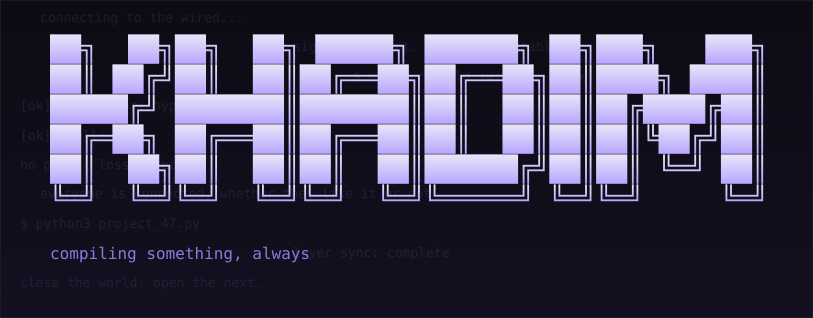
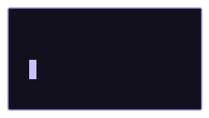
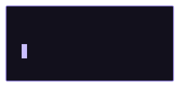

<div align="center">



<br/>



### _no matter where you go, everyone's connected._

</div>

---

### 🕸️ ORIGIN

Somewhere between a terminal and a lecture hall, a student started rebuilding
his own machine from scratch — system, window manager, shell, editor, all of it —
until the OS felt less like a tool and more like a room he lived in.
He's still in there. Still rebuilding. Still not fully connected.

---

### 📋 FILE — LAYER 07

| ATTRIBUTE | VALUE |
| --- | --- |
| Name | Khadim |
| Also known as | `khadimshiny2-beep`/hopemaxxer221 |
| Base of Operations | Dakar, Senegal |
| Current Form | 1st year Data & AI student |
| Power | Debugging by staring at the wall in silence, always thirsty of learning new skills, Linux enjoyer |
| Weakness | Off-by-one errors, dotfiles, 3 AM rabbit holes |
| Sidekick | A NixOS config that's never quite "done" (and will never be) |
| Catchphrase | "just one more rice before I sleep" |
| Signal | Serial Experiments Lain, quietly, in the background |

---

### 👁️ THINGS LURKING IN THE WIRED

| ENTITY | THREAT LEVEL | STATUS |
| --- | --- | --- |
| The Merge Conflict | ▓▓▓▓░ | contained, barely |
| Segfault at 2 AM | ▓▓▓▓▓ | undefeated |
| The Unfinished Portfolio | ▓▓▓░░ | still rendering |
| The Poorly Mastered Courses | ▓▓▓▓░ | not yet fatal |
| The Scholarship Deadline | ▓▓▓▓▓ | approaching |
| The Computer Science Rabbit Hole | ▓▓▓▓▓▓▓▓▓ | the bottomless pit |

---

### 🎒 INVENTORY

<p>

</p>

🐍 `python` ⚙️ `c` 🦀 `rust` 🗃️ `sql` 🌐 `html` 🎨 `css` ⚡ `javascript` 🐧 `linux` ❄️ `nixos` 📝 `neovim` 🐟 `fish` 🖥️ `tmux` 📓 `jupyter` 📦 `conda` 🐘 `postgresql` 🍃 `mongodb` 🌿 `git` 🏔️ `arch/omarchy`

```
🐍 python       → the everyday key, opens most doors
⚙️ c            → lighter, faster, breaks easily
🦀 rust         → the one still being forged, sharp when it's done
🗃️ sql          → how you talk to things that remember
🐘 postgres     → where the memories live
🍃 mongodb      → the memories with no fixed shape
🌐 html/css/js  → the surface, what The Wired shows to outsiders
📓 jupyter      → the notebook where the experiments happen
📦 conda        → keeping the experiments from contaminating each other
🐧 linux        → not a tool, a whole way of living
❄️ nixos        → the lair itself, rebuilt from a single config file
🅰️ arch/omarchy → the second room, Hyprland glowing in the dark
🌿 git          → the time machine, undoes mistakes (most of them)
📝 neovim/fish/zsh  → how you move through it without touching a mouse
```

---

### 📊 SIGNAL STRENGTH

<div align="center">


<br/><br/>


<br/>


</div>

---

### 📡 MISSION LOG

```
[ACTIVE]       99 python projects — one small thing at a time
[ACTIVE]       cool-python-stuff — random small scripts and experiments, kept just because they're fun
[SOON]         cybersecurity detour — kali, parrotOS, tryhackme, htb
[LONG-TERM]    portfolio site — live, but never finished
[LONG-TERM]    finding a way out — grad school, somewhere else
[LONG-TERM]    nix config — still building the lair
```

---

### 🚪 MEET ME OUTSIDE OF THE WIRED

<pre>
email               → <a href="mailto:khadimparsine2@gmail.com">khadimparsine2@gmail.com</a>
portfolio (french)  → <a href="https://khadimshiny2-beep.github.io/portfolio-web/">https://khadimshiny2-beep.github.io/portfolio-web/</a>
linkedin            → <a href="https://www.linkedin.com/in/ahmadoul-khadim-gueye-b503743a6/">https://www.linkedin.com/in/ahmadoul-khadim-gueye-b503743a6/</a>
</pre>

---

<div align="center">



<sub>thanks for stopping by The Wired.</sub>

</div>